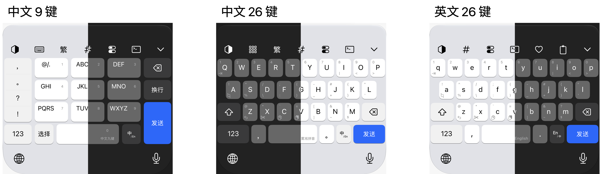

## Demo 



## 皮肤简介

本键盘皮肤在「空山素影」皮肤的基础上做了以下自定义修改。以下修改由 Github Copilot & ChatGPT 支持。

### 修改 1：工具栏增加【 9 键 / 26 键】切换按钮

通过中文键盘工具栏上的该切换按钮，可以同时切换键盘布局（9 键 / 26 键）和输入方案：

- 9 键布局对应「中文九键」方案。
- 26 键布局对应「雾凇拼音」方案。

默认情况下，中文键盘布局时，该按钮固定在工具栏最左侧（键盘菜单按钮右侧）。英文键盘不显示该按钮。

按钮代号「28」，可在 `toolbarSlideButtons` 中配置或移除。修改后需重新编译皮肤。若按钮没有显示，请检查元书是否启用了自定义工具栏。

> [!caution]
>
> 使用前请注意：
>
> - 在元书的方案列表中启用并部署中文九键和雾凇拼音。默认方案 ID 分别为 `t9` 和 `rime_ice`；如果实际 ID 不同，可在 `./jsonnet/Settings.libsonnet` 中修改 `layoutSwitchSchema9` 和 `layoutSwitchSchema26`。
> - 当 `keyboardLayout` 设为 `9`、`26` 或 `26b`，且 `toolbarSlideButtons` 包含 `28` 时，中文键盘工具栏会显示切换按钮。修改设置后需要重新编译皮肤。
> - 切换前建议先完成当前输入；未上屏内容的处理取决于元书和 Rime。
> - 此功能使用元书的组合动作，需要支持 `combine` 的元书版本（官方文档注明 TestFlight 349 及以上）。英文和自定义数字、符号键盘的返回按钮使用「返回上一个键盘」。
> - 元书内置符号或表情键盘可能自动返回默认中文键盘；重新打开键盘或通过其他入口单独切换方案时，布局也不一定自动跟随。若布局与方案不匹配，可用工具栏按钮重新切换，并检查空格键上的方案名称。返回和恢复行为仍需在实际设备上验证。

### 修改 2：工具栏增加「简/繁」切换按钮

点击工具栏上的【简/繁】切换按钮，可切换简体和繁体输入。

此功能直接切换 Rime 的 `traditionalization` 选项，需要当前方案支持该选项，并使用元书商店版 1.8.0 或 TestFlight 504 及以上版本。

按钮显示目标状态：当前为简体时显示「繁」，当前为繁体时显示「简」。

默认情况下，中文键盘布局时，「简/繁」切换按钮位于「9 键 / 26 键」布局切换按钮右侧，固定在工具栏左侧显示（键盘菜单按钮右侧）。英文键盘不显示该按钮。

未启用「9 键 / 26 键」布局切换按钮时，「简/繁」切换按钮固定工具栏最左侧显示。

按钮代号为「29」，可在 `toolbarSlideButtons` 中配置或移除。修改后需重新编译皮肤。若按钮没有显示，请检查元书是否启用了自定义工具栏。

### 修改 3：移除皮肤自带的浮动面板，使用元书键盘菜单

工具栏最左侧的按钮打开元书的键盘菜单，不再打开「空山素影」皮肤自带的浮动面板。菜单内容可在元书的「键盘菜单设置」中调整。

### 修改 4：26 键键盘开启下滑提示

在所有按键下方显示当前按键的下滑功能提示。

### 修改 5: 皮肤外观微调

- 微调浅色键盘的「系统按键」（如 删除、Shift 键 等）背景颜色。
- 「空格键」显示当前输入方案的位置改到右下角。
- 「九键」和「 26 键」键盘在横屏时缩小字母键文字，由 22.5/21.5 调整至 16 ，减少与上下滑提示重叠。
- 竖屏「 26 键」键盘，字母键文字大小减小至 18 。
- 键盘皮肤的字母位置微调，上滑提示与下滑提示位置微调。
- 中英文 26 键的「退格键」和「Shift 键」加宽。「退格键」左侧边缘与「 L 」键对齐；左侧「Shift 键」右侧边缘与「 A 」键对齐。底行「回车键」设置为两个标准键宽，与「退格键」对齐，空格键填充剩余空间。
- 移除「空格键」中央的空格图标。

### 修改 6: 修改 26 键键盘的长按动作

为字母的长按增加扩展字母，比如，长按「 `a` 」会出现「 `a` 」、「 `A` 」、「 `ā` 」、「 `á` 」、「 `ǎ` 」、「 `à` 」等字符。

### 修改 7: 修改 9 键键盘的长按动作，取消上滑输入数字的动作

在「中文九键」键盘中取消上滑输入数字的动作，同时增加长按选择输入字母或者数字的动作。

### 修改 8：26 键增加句号键

- 中文和英文 26 键键盘的空格键右侧增加句号键，分别输入「。」和「.」。
- 逗号键不再支持上滑，空格键中央的空格图标也已移除。

### 修改 9：候选词颜色修改为主题色

将选中的候选词背景框颜色修改为主题色，候选词、序号和注释使用白色加粗字体（但加粗似乎不太明显）。

## 在 iPhone 上安装

1. 下载并解压本仓库的源码。
2. 在 iPhone 的「文件」App 中，进入「我的 iPhone」→「元书输入法」→ `Skins`，新建一个皮肤文件夹，例如「空山素影」。
3. 将源码文件复制到该文件夹中，保留 `jsonnet`、`light` 和 `dark` 目录及其层级。`light` 和 `dark` 可以暂时为空，编译时会生成配置文件。
4. 打开元书输入法的「键盘皮肤」页面，长按「空山素影」，选择「运行 main.jsonnet」进行编译。完成后选择该皮肤，并在输入框中重新唤起键盘。

首次安装时，无生成配置的源码目录能否直接出现在皮肤列表中尚未实机验证。如果列表中没有该皮肤，可以先按下方说明在电脑上编译，再将生成的文件连同源码一起复制到手机。

## 在电脑上编译

安装 `jsonnet` 命令行工具，在仓库根目录运行：

```shell
# Windows
jsonnet -S -m . --tla-code debug=true .\jsonnet\main.jsonnet

# Linux / macOS
jsonnet -S -m . --tla-code debug=true ./jsonnet/main.jsonnet
```

编译会生成 `config.yaml` 以及 `light`、`dark` 目录下的 YAML 文件。

## 原皮肤 GitHub 仓库

- [空山素影](https://github.com/luozikuan/kongshan-suying)
- [最新版本发布地址](https://github.com/luozikuan/kongshan-suying/releases/latest)
- [配套测试方案](https://github.com/luozikuan/rime-tailor)
